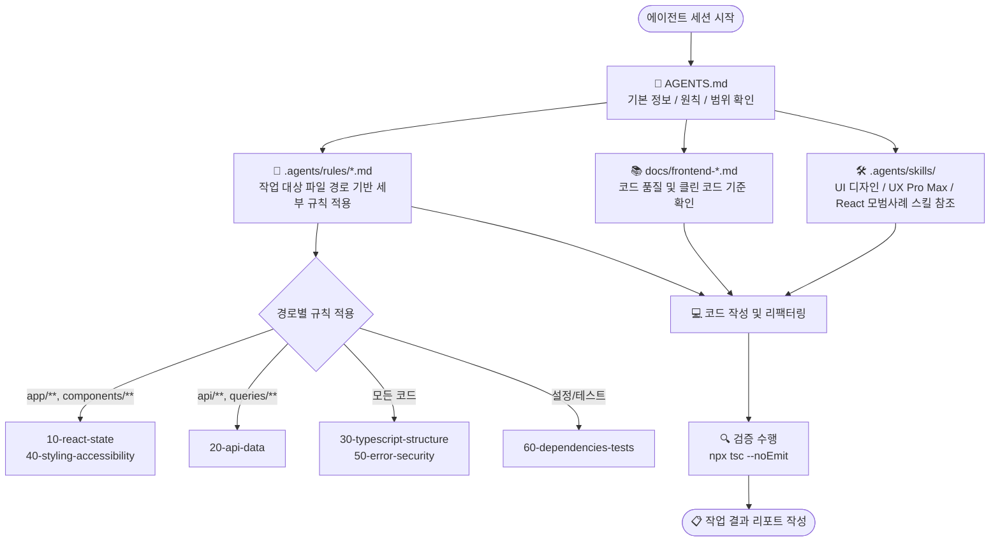

<div align="center">

# 📱 MyFirstApp

**Expo & React Native 기반 모바일 앱 + 일관된 AI 협업을 위한 Agent Harness**

<p align="center">
  
  
  
  
  
  
  
</p>

[📌 개요](#-프로젝트-개요) •
[🛠 기술 스택](#-기술-스택) •
[🚀 빠른 시작](#-빠른-시작) •
[📂 디렉토리 구조](#-디렉토리-구조) •
[🤖 에이전트 하네스](#-에이전트-하네스-구성) •
[🔄 작업 흐름](#-에이전트-작업-흐름)

---
</div>

## 📌 프로젝트 개요

**MyFirstApp**은 최신 **Expo (SDK 57)** 및 **React Native (0.86)** 생태계를 기반으로 구축된 크로스 플랫폼 모바일 애플리케이션입니다.  
본 저장소는 완성도 높은 앱 코드뿐만 아니라, AI 코딩 에이전트(Antigravity, Claude Code 등)가 일관된 기준과 높은 코드 품질로 협업할 수 있도록 설계된 **계층형 에이전트 하네스(Agent Harness)** 체계를 내장하고 있습니다.

### ✨ 핵심 특징

- 🚀 **모던 모바일 스택**: Expo Router 기반 파일 라우팅 및 NativeWind v4(Tailwind CSS) 스타일링
- 🎯 **엄격한 타입 안전성**: TypeScript `strict` 모드 기반 견고한 코드베이스
- 🤖 **에이전트 하네스 체계**: `AGENTS.md` ➔ `.agents/rules/` ➔ `.agents/skills/` ➔ `docs/`로 이어지는 다계층 룰 엔진
- 🔄 **멀티 에이전트 호환**: Claude Code 전용 미러(`.claude/`)와의 완벽한 동기화 구조

---

## 🛠 기술 스택

| 영역 | 기술 / 라이브러리 | 버전 / 스펙 | 상태 | 비고 |
| :--- | :--- | :--- | :---: | :--- |
| **Runtime** | Expo SDK / React Native / React | `57.0.14` / `0.86.2` / `19.2.3` |  | 코어 플랫폼 |
| **Language** | TypeScript | `~6.0.3` (`strict`) |  | 타입 안정성 보장 |
| **Routing** | Expo Router | `~57.0.14` |  | 파일 기반 라우팅 (`app/`) |
| **Styling** | NativeWind / Tailwind CSS | `^4.2.6` / `^3.4.19` |  | 유틸리티 퍼스트 스타일링 |
| **Animation** | React Native Reanimated | `4.5.1` |  | 고성능 인터랙션 |
| **Server State** | TanStack Query | — |  | 필요 시 승인 후 설치 |
| **Client State** | Zustand | — |  | 필요 시 승인 후 설치 |
| **HTTP Client** | axios | — |  | 필요 시 승인 후 설치 |
| **Icon / Font** | lucide-react-native / IBM Plex Sans KR | — |  | 필요 시 승인 후 설치 |
| **Linting** | ESLint (`expo lint`) | — |  | 도입 예정 |
| **Package Manager** | pnpm | `11.13.0` |  | npm / yarn 사용 금지 |

---

## 🚀 빠른 시작

### 1. 패키지 설치

본 프로젝트는 **`pnpm`**을 전용 패키지 매니저로 사용합니다.

```bash
pnpm install
```

> [!WARNING]
> `npm` 또는 `yarn` 명령어는 사용하지 마세요. 네이티브 모듈이 포함되거나 Expo SDK 버전에 민감한 패키지는 `pnpm expo install <패키지명>`으로 설치합니다.

### 2. 개발 서버 구동

```bash
# 통합 개발 서버 실행 (터미널에서 a/i/w 단축키로 플랫폼 전환 가능)
pnpm start

# 플랫폼별 직접 실행
pnpm android   # Android 에뮬레이터 또는 연결된 기기
pnpm ios       # iOS 시뮬레이터 (macOS 환경)
pnpm web       # 웹 브라우저
```

### 3. 검증 명령어

코드 변경 후에는 반드시 아래 검증 명령을 수행합니다.

```bash
# TypeScript 정적 타입 검사
npx tsc --noEmit
```

| 검증 명령 | 상태 | 설명 |
| :--- | :---: | :--- |
| `npx tsc --noEmit` | ✅ 사용 가능 | TypeScript 타입 에러 검출 |
| `npx expo lint` | ⏸️ 미설치 | ESLint 도입 후 활성화 예정 |

---

## 📂 디렉토리 구조

```text
MyFirstApp/
├── 📄 AGENTS.md                  # 🌟 에이전트 지침 진입점 (프로젝트 스택, 범위, 디자인, 보고 규칙)
├── 📄 CLAUDE.md                  # Claude Code 진입점 (@AGENTS.md 링크)
├── 📁 .agents/                   # 🤖 에이전트 하네스 정본
│   ├── 📁 rules/                 # 경로(paths) 기반 세부 규칙 (00-baseline ~ 60-dependencies-tests)
│   └── 📁 skills/                # 작업 특화 에이전트 스킬 모음
├── 📁 .claude/                   # 🪞 Claude Code 전용 미러
│   ├── 📁 rules/                 # .agents/rules/ 와 100% 동기화된 미러
│   ├── 📁 skills/                # Claude 환경 노출 스킬
│   └── 📄 settings.json          # Claude Code 권한 및 MCP 도구 설정
├── 📁 docs/                      # 📚 코드 품질 기준 및 가이드라인
├── 📄 skills-lock.json           # 외부 스킬 출처 및 체크섬 잠금 파일
│
├── 📁 app/                       # 📱 Expo Router 파일 기반 라우트 (화면 조립 및 라우팅 전용)
│   ├── 📄 _layout.tsx            # 루트 Stack 레이아웃 및 global.css 로드
│   └── 📄 index.tsx              # 홈 화면 (할 일 목록 샘플)
├── 📁 components/                # 🧩 재사용 UI 컴포넌트 (공용 컴포넌트는 components/ui/) [예정]
├── 📁 hooks/                     # 🪝 재사용 커스텀 훅 [예정]
├── 📁 lib/                       # 🛠 순수 유틸리티 함수 [예정]
├── 📁 assets/                    # 🎨 이미지, 아이콘, 폰트 에셋
│
├── 📄 global.css                 # NativeWind / Tailwind CSS 전역 지시문
├── 📄 tailwind.config.js         # NativeWind 테마 토큰 및 프리셋 설정
├── 📄 babel.config.js            # Expo 및 NativeWind 바벨 플러그인 설정
├── 📄 metro.config.js            # Metro 번들러 NativeWind CSS 연동 설정
├── 📄 app.json                   # Expo 설정 (Scheme, App Icon, Splash 등)
├── 📄 tsconfig.json              # TypeScript 설정 (strict 모드)
└── 📄 package.json               # 프로젝트 메타데이터 및 의존성 목록
```

> [!NOTE]
> `components/`, `hooks/`, `lib/` 디렉토리는 첫 관련 파일이 생성되는 시점에 추가됩니다. 화면 라우트가 아닌 파일은 `app/` 디렉토리에 배치하지 않습니다.

---

## 🤖 에이전트 하네스 구성

에이전트 하네스는 AI 코딩 에이전트가 프로젝트 컨텍스트를 빠르고 정확하게 파악하고 일관된 기준에 맞춰 작업할 수 있도록 설계된 아키텍처입니다.



### 1. `AGENTS.md` (진입점)
모든 에이전트가 가장 먼저 참조하는 최상위 지침 파일입니다.
- 프로젝트 기본 스택 및 디렉토리 역할 정의
- 문서 적용 우선순위 및 충돌 처리 규칙 (사용자 요청 최우선)
- 승인이 필요한 민감 작업(패키지 변경, 설정 파일 광범위 변경, 파일 삭제 등) 명시
- 디자인 방향성(블루 신뢰 톤, slate 서피스, 4px 그리드, 44pt 터치 타깃 등)
- 사실에 기반한 완료 보고 원칙 (미확인 수치는 `TBD` 표기)

### 2. `.agents/rules/` (경로 기반 세부 규칙)
작업 대상 파일의 경로(`paths` frontmatter)에 따라 선별적으로 적용되는 규칙 집합입니다.

| 파일명 | 주요 적용 대상 | 핵심 내용 |
| :--- | :--- | :--- |
| `00-baseline.md` | `app/`, `components/`, `hooks/`, `lib/`, 엔트리/설정 | 기본 원칙, 범위 준수, NativeWind 전용, TanStack Query 원칙 |
| `10-react-state.md` | `app/`, `components/`, `hooks/` | 상태 5단계 분류(서버/내비게이션/폼/로컬/파생), Query/Zustand 선택 기준 |
| `20-api-data.md` | `api/`, `**/queries/`, `*.query.ts` | 5계층 호출 구조, Query Key 팩토리, AbortSignal, 낙관적 업데이트 |
| `30-typescript-structure.md` | `app/`, `components/`, `hooks/`, `lib/` | `strict` 타입, `any`/`@ts-ignore` 금지, 컴포넌트 단일 책임, 파일 배치 |
| `40-styling-accessibility.md` | `app/`, `components/`, `global.css` | 디자인 토큰, `Pressable`/`FlatList` 표준, SafeArea, 모바일 접근성 속성 |
| `50-error-security.md` | `app/`, `components/`, `hooks/`, `lib/`, `.env*` | 상황별 예외 처리 UX, 로깅 규칙, 보안 스토리지(`expo-secure-store`) |
| `60-dependencies-tests.md` | `package.json`, `pnpm-lock.yaml`, 설정/테스트 | pnpm 전용, `pnpm expo install`, 사전 승인, jest-expo + RNTL 기준 |

> [!NOTE]
> `.claude/rules/`는 위 파일들의 100% 동기화 미러입니다. 규칙 수정 시 두 디렉토리를 항상 일치시킵니다.

### 3. `.agents/skills/` (전문 스킬)

| 스킬명 | 출처 | 용도 및 프로젝트 적용 가이드 |
| :--- | :--- | :--- |
| `frontend-design` | anthropics/skills | 템플릿 느낌을 벗어난 의도적 비주얼 방향성 수립 (UI 작업 전 필독, RN 번안) |
| `ui-ux-pro-max` | ui-ux-pro-max | 스타일·컬러 팔레트·타이포그래피 및 React Native UI/UX 지침 제공 |
| `vercel-react-best-practices` | vercel-labs | React 성능 최적화 가이드 (리렌더링·커스텀 훅 관련 규칙 적용) |
| `design` / `design-system` / `brand` | claudekit | 디자인 토큰, 브랜드 아이덴티티 및 슬라이드/배너 가이드 |
| `ui-styling` | claudekit | Tailwind CSS 유틸리티 및 스타일 패턴 참고용 |

### 4. `docs/` (코드 품질 기준)

| 문서 | 적용 여부 | 주요 내용 |
| :--- | :---: | :--- |
| `frontend-code-quality.md` | **적용** | 토스 Frontend Fundamentals 기반 4대 원칙 (가독성 · 예측 가능성 · 응집도 · 결합도) |
| `frontend_clean_code_guide.md` | **적용** | SLASH 21 "Frontend Clean Code" 실천 지침 및 체크리스트 |
| `frontend-spec.md` 외 기타 문서 | **미적용** | 이전 웹 프로젝트 아카이브 문서 (참고용, 본 프로젝트에 적용하지 않음) |

---

## 🔄 에이전트 작업 흐름

```text
[1. 지침 확인]  AGENTS.md를 읽고 작업 범위 및 승인 필요 여부 파악
       ▼
[2. 규칙 매칭]  작업 대상 파일의 경로에 해당하는 .agents/rules/*.md 로드
       ▼
[3. 품질 기준]  docs/frontend-*.md 및 관련 스킬(frontend-design 등) 확인
       ▼
[4. 코드 구현]  React Native 코어 컴포넌트 + NativeWind 기반 구현
       ▼
[5. 품질 검증]  npx tsc --noEmit 실행하여 타입 정합성 검증
       ▼
[6. 결과 보고]  실제 확인된 사실만 기록하고 미확인 항목은 TBD로 보고
```

> [!IMPORTANT]
> **사전 승인이 반드시 필요한 작업:**
> 1. 새로운 패키지 설치 (`pnpm expo install` / `pnpm add`), 패키지 제거, SDK 버전 업그레이드
> 2. 주요 설정 파일(`app.json`, `babel.config.js`, `metro.config.js`, `tailwind.config.js` 등)의 광범위한 수정
> 3. 기존 파일의 삭제 또는 대규모 파일 이동
> 4. 공개 API 인터페이스의 변경

---

## 🛠 하네스 유지보수 가이드

- **새로운 규칙 작성**: `.agents/rules/NN-topic.md` 형식으로 작성하고 상단에 `paths` frontmatter를 명시합니다. 수정 후 반드시 `.claude/rules/`에 동일하게 복사하여 미러를 유지합니다.
- **미러 무결성 검증**:
  ```bash
  diff -r .agents/rules .claude/rules
  ```
  위 명령어 실행 시 차이점이 없어야 합니다.
- **외부 스킬 관리**: 외부에서 도입한 스킬은 `skills-lock.json`에 출처 리포지토리와 커밋 해시를 기록하여 버전 추적성을 보장합니다.

---

## 📄 라이선스

This project is licensed under the [MIT License](file:///C:/Users/SSAFY/Desktop/reactnative/MyFirstApp/LICENSE).  
각 스킬 및 라이브러리는 해당 저장소의 고유 라이선스(`SKILL.md` frontmatter 또는 `LICENSE.txt`)를 따릅니다.

